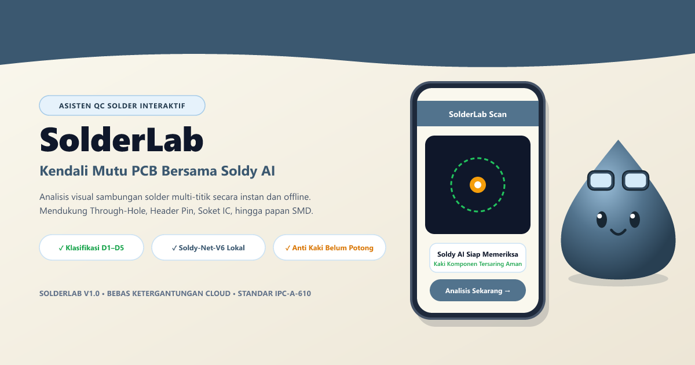
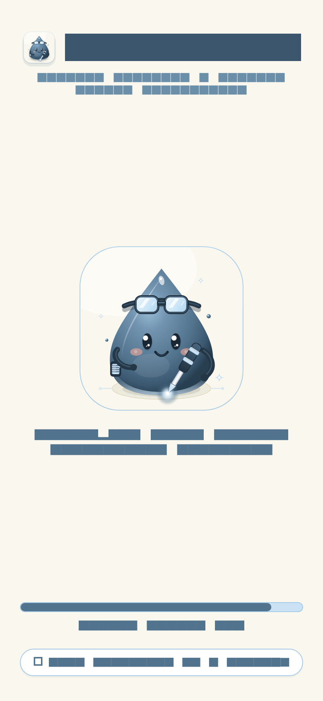
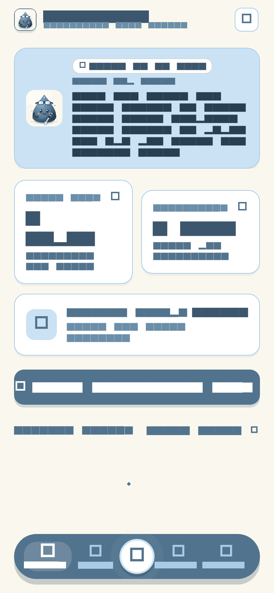
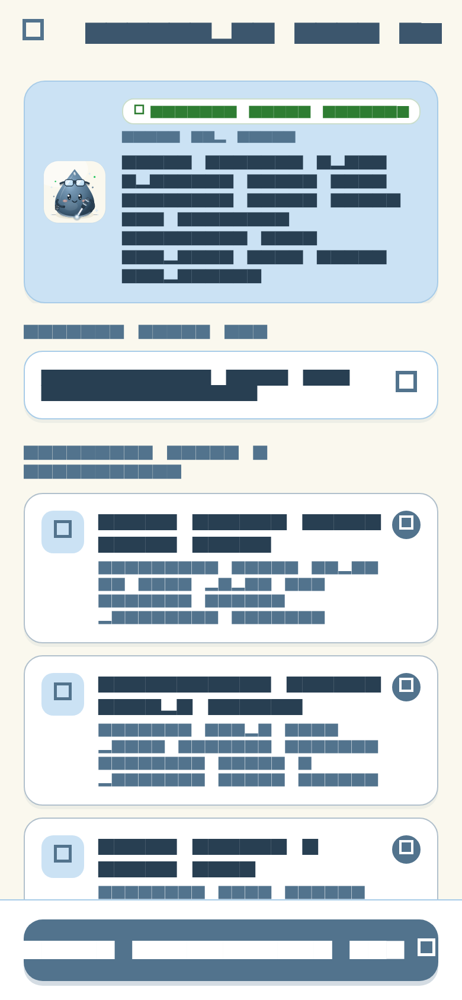
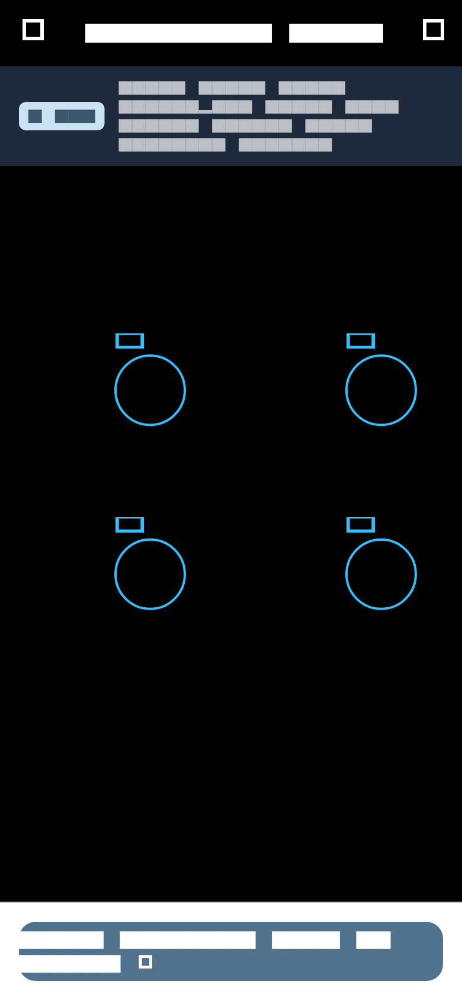
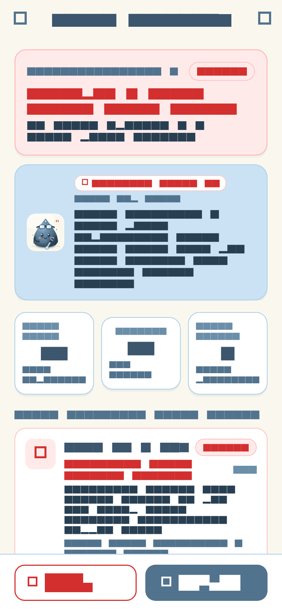
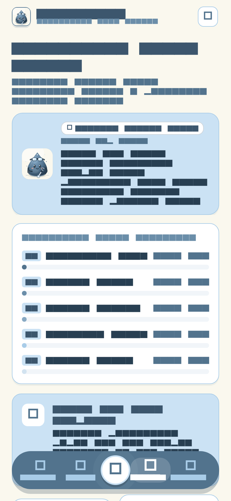

# SolderLab

<p align="center">
  
</p>

**SolderLab** is an offline-first **PCB Solder Quality Control (QC)** application built with Flutter and powered by **Soldy AI** (`Soldy-Net-V6`) — a pure-Dart, on-device inspection engine designed for general THT, SMD, header, IC socket, and custom PCBs.

---

## Core Capabilities

- **On-Device `Soldy-Net-V6` Hybrid AI**
  - 48-dimensional domain-invariant geometric & photometric extractor ([soldy_features.py](ai_training/soldy_features.py) synced bit-for-bit with [solder_model_engine.dart](lib/services/ai/solder_model_engine.dart)).
  - Ensemble of standardized MLPs (`48 -> 160 -> 80 -> 7`) + Depth-8 ExtraTrees exported as pure JSON ([soldy_v6_model.json](assets/models/soldy_v6_model.json)) — **zero TFLite native binary friction**.
  - Validated on held-out multi-source data (`N = 3,823`): **93.59% Accuracy**, **90.39% Macro-F1**, **93.65% `NON_SOLDER` Rejection**.
- **Uncut Component Lead & Edge Guard**
  - Hue-clustered PCB segmentation (`RED`, `GREEN`, `BLUE`, `YELLOW`) with 4-direction interior bevel guard and 16-ray gap-tolerant wire/crossing rejection ([solder_localizer_service.dart](lib/services/ai/solder_localizer_service.dart)) so uncut component legs and bench clutter are filtered before review.
- **Zero-Jank Background Isolate Pipeline**
  - Full 12MP decode, optical quality assessment (blur/exposure/glare), downscaling, CV localization, cropping, and AI classification run inside `Isolate.run(...)` ([ai_inference_service.dart](lib/services/ai/ai_inference_service.dart)).
- **Interactive Soldy Mascot & UX**
  - Animated mascot companion (`SoldyAvatarAnimated`, breathing, natural blinking, reactive `SoldyMood` expressions) and tappable coaching banner (`SoldyCoachBanner`) with reduced-motion and test-safe support.
  - Persistent Bahasa Indonesia (`id` default) and English (`en`) localization, 1-tap manual joint override in inspection detail, SQLite v4 analytics/Pareto charts, `qc_staging` cache cleanup, and PDF/CSV export.

---

## Visual Preview

| Splash & Soldy AI | Dashboard Beranda | Setup Meja QC | Kalibrasi Titik | Hasil Soldy AI | Statistik Pareto |
| :---: | :---: | :---: | :---: | :---: | :---: |
|  |  |  |  |  |  |

---

## Defect Taxonomy (7 Classes)

| Code | Status | Description |
| :--- | :---: | :--- |
| `PASS_NORMAL` | `PASS` | Clean concave solder fillet wetting pin & pad (`< 90°`) |
| `D1_BRIDGE` | `FAIL` | Unintended solder bridge shorting adjacent pads or leads |
| `D2_COLD` | `FAIL` | Dull, disturbed, or grainy cold solder joint |
| `D3_INSUFFICIENT` | `FAIL` | Starved solder volume / open barrel / poor pad wetting |
| `D4_EXCESS` | `FAIL` | Bulbous overfilled solder blob hiding pin contour |
| `D5_PINHOLE` | `FAIL` | Gas pinhole / void / blowhole on solder surface |
| `NON_SOLDER` | Filtered | Uncut component wire leads, bare traces, component bodies, bench background |

---

## Repository Structure

```text
├── lib/                    # Clean-architecture Flutter app (core, data, services, features, presentation)
├── assets/
│   ├── branding/           # App icons, hero covers, Soldy SVGs & raster PNGs
│   └── models/             # Soldy-Net-V6 model weights, metadata, labels.txt
├── test/                   # Unit, widget, screenshot, isolate perf & anonymized PCB fixture suites
├── ai_training/            # Python feature extractor, dataset builder & Soldy-Net-V6 training scripts
├── design/                 # qc_solder_ui.figcraft UI/UX artboard source
└── docs/                   # Real engine screenshot renders
```

---

## Running & Testing

```bash
# Install Dart/Flutter dependencies
flutter pub get

# Static analysis
flutter analyze --no-pub

# Run complete unit, widget, screenshot & on-device AI verification suite
flutter test --no-pub --reporter expanded
```

To retrain `Soldy-Net-V6` from custom labeled image folders or re-run offline Python validation, see [ai_training/README.md](ai_training/README.md).
